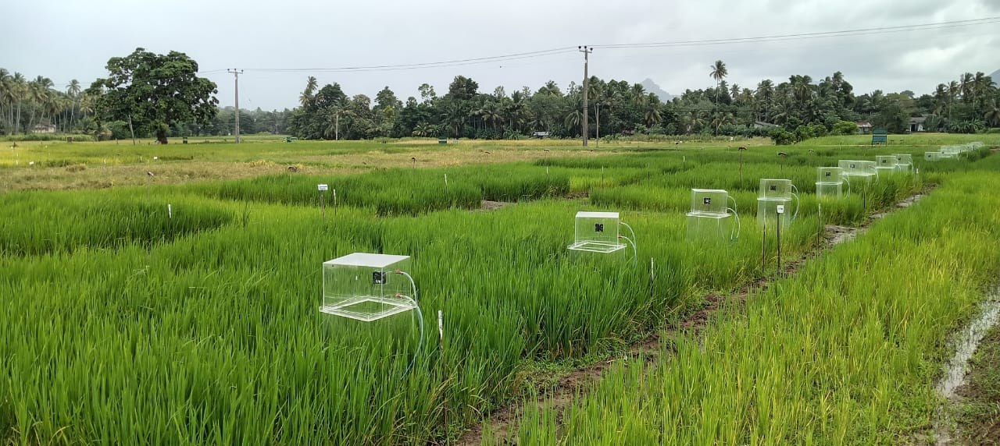
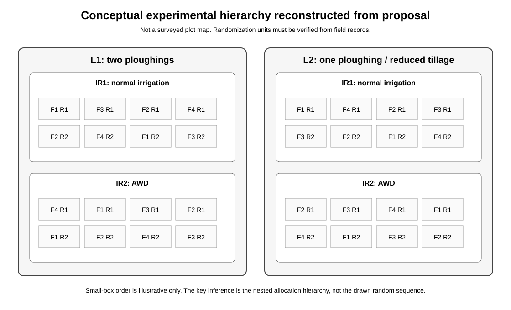
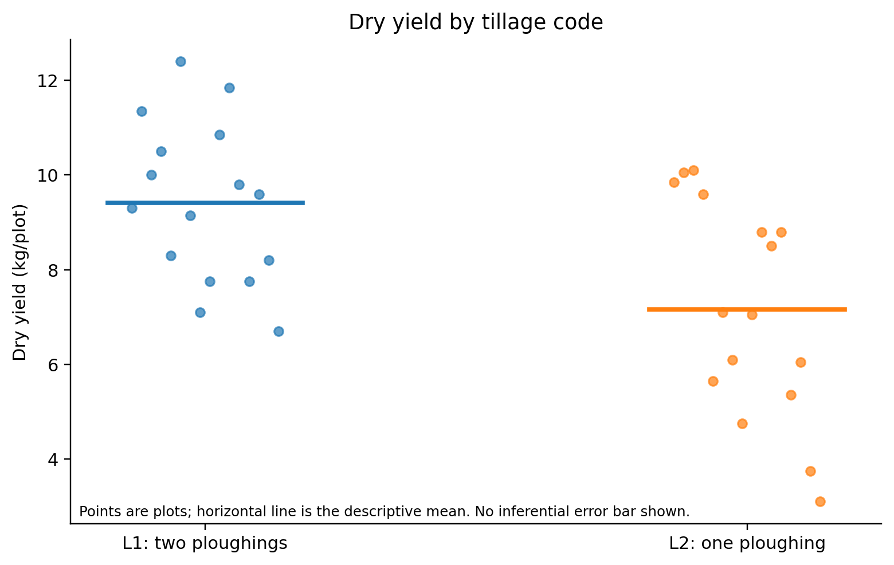

# Feasibility Assessment of Improved Agricultural Land Management Practices for Methane Mitigation in Sri Lankan Rice Systems

**Field evaluation of alternate wetting and drying, reduced tillage, nutrient management, crop productivity, and the evidence requirements for carbon-credit quantification.**

This repository is a reproducible academic reconstruction of a 2025 paddy-field feasibility study conducted at a Sri Lankan rice research site. It is designed as a research portfolio: the purpose is to make the experimental structure, data limitations, analytical choices, and carbon-methodology questions inspectable rather than to present a carbon-credit marketing claim.

> **Current evidence status:** the supplied package contains 32 plot-level agronomic outcome records and 32 longitudinal crop-growth series, but it does **not** contain the raw greenhouse-gas measurement series needed to estimate seasonal CH4, N2O, or CO2 fluxes. The September 2025 progress report also described the project as still collecting gas measurements and still awaiting harvest/emissions compilation and comprehensive methodology verification work. No statement in this repository should be read as evidence that credits were validated, verified, issued, or that additionality was demonstrated.

## Researcher role

During the underlying feasibility project, the portfolio author served as **Head of Impact Investments and Sustainability** for the private-sector project partner, with responsibilities spanning carbon-program design, methodology work, technical/financial documentation, and engagement with government/research counterparts. This public repository is the author's analytical reconstruction and reproducibility layer. It does not imply that the author personally collected every field measurement or authored every institutional source document. See [`docs/author-role.md`](docs/author-role.md).



## Research questions

The portfolio is organized around four questions.

1. How did crop productivity vary descriptively across the observed tillage, irrigation, and nutrient-management codes?
2. Can the available design documentation support valid causal or factorial inference for those differences, or are the randomization and experimental units insufficiently documented?
3. What additional measurements are required before the study can say anything defensible about CH4, N2O, CO2, yield-scaled climate outcomes, or carbon-credit quantification?
4. How should a 2025 field study framed around Verra VM0042 be interpreted in light of the current methodology landscape, including the rice-specific VM0051 now active at Verra?

## Hypotheses and estimands

The agronomic hypotheses are deliberately separated from the GHG hypotheses. For dry yield, the primary current estimands are the contrasts among coded tillage, irrigation, and nutrient treatments, conditional on recovery of the correct assignment units. For GHG outcomes, the prospective hypothesis is that AWD may reduce seasonal CH4 relative to normal irrigation, while N2O can move in the opposite direction; the sign and magnitude of total climate impact must therefore be measured rather than assumed. Reduced tillage and nutrient management are likewise treated as empirical treatment dimensions, not predetermined mitigation successes.

No crop-rotation treatment is encoded in the 32-row outcome dataset, and crop rotation is not introduced as a study factor in this public reconstruction. Full hypotheses and decision rules are in [`docs/research-questions-hypotheses.md`](docs/research-questions-hypotheses.md).

## Experimental reconstruction

The final outcome workbook contains all combinations of:

| Factor | Code | Public interpretation | Levels |
|---|---|---|---:|
| Tillage | L | L1: two ploughings / conventional-intensity comparator; L2: one ploughing / reduced tillage | 2 |
| Irrigation | IR | IR1: normal irrigation; IR2: alternate wetting and drying (AWD) | 2 |
| Nutrient treatment | F | F1-F4; public-safe definitions are in `data/metadata/treatment_codebook.csv` | 4 |
| Plot replicate | R | R1, R2 | 2 |

This gives **2 x 2 x 4 x 2 = 32 observed plot records**. The important qualification is that 32 observations are not automatically 32 independent experimental units for every factor. The proposal schematic appears hierarchical: large tillage sections, irrigation sections nested within tillage, and nutrient-treatment plots within those sections. The supplied outcome table has no block identifier, whole-plot identifier, or randomization map. Consequently, standard plot-level three-way ANOVA may overstate the precision of tillage and irrigation effects if those factors were not independently replicated at their assignment level. See [`docs/experimental-design.md`](docs/experimental-design.md) and [`docs/statistical-identification.md`](docs/statistical-identification.md).



## What F1-F4 mean, and what remains unresolved

The source package does allow the treatment codes to be reconstructed, but it does **not** support pretending that every operational detail has been reconciled.

| Code | Public-safe treatment interpretation | Status |
|---|---|---|
| F1 | Full recommended mineral fertilizer plus organic manure | Provisional; one application schedule creates a discrepancy about proprietary-input use |
| F2 | Reduced recommended mineral fertilizer plus organic manure and a proprietary organic input | Broadly supported; product identity, proportions, and dosing intentionally withheld |
| F3 | Full recommended mineral fertilizer; residue component unresolved | Proposal mentions previous-season straw, while the code-mapping workbook does not |
| F4 | No-fertilizer control | Consistent across sources |

The repository therefore treats the nutrient factor as **coded treatments** in all statistical output. It does not publish product-specific application rates and does not use unresolved treatment details to support causal claims. The audit trail is in [`docs/treatment-definition-audit.md`](docs/treatment-definition-audit.md).

## Descriptive yield results

The primary agronomic endpoint currently available is dry yield per plot. Marginal averages are:

| Comparison | Mean dry yield (kg/plot) | Descriptive difference |
|---|---:|---:|
| L1: two ploughings | 9.41 | reference |
| L2: one ploughing / reduced tillage | 7.16 | 23.9% lower than L1 |
| IR1: normal irrigation | 8.83 | reference |
| IR2: AWD | 7.74 | 12.3% lower than IR1 |
| F1 | 9.38 | coded treatment mean |
| F2 | 9.89 | coded treatment mean |
| F3 | 7.78 | coded treatment mean |
| F4 | 6.11 | coded treatment mean |

These are **descriptive plot averages**. They are not presented as valid treatment-effect estimates until the experimental-unit problem is resolved. In particular, a lower yield under reduced tillage does **not** show that reduced tillage “failed Verra additionality.” Agronomic performance, methodology applicability, baseline construction, additionality, leakage, monitoring, and quantification are separate questions.



The cell-level means and all public figures can be regenerated with:

```bash
python analysis/python/reproduce_all.py
```

## Why the repository does not foreground p-values

A conventional balanced three-factor ANOVA can be calculated mechanically from the 32 rows, and an explicitly labelled **naive exploratory** version is included in `analysis/outputs/exploratory_naive_anova.csv`. It is not used as confirmatory evidence. If tillage and irrigation were applied to unreplicated or weakly replicated whole plots, the plot-level residual is the wrong error term for those factors. Reporting apparently precise p-values in that situation would be pseudoreplication, not sophistication.

The appropriate next model depends on recovering the physical randomization record. If true blocks and split-plot assignment units exist, the analysis can move to a mixed/split-plot model with error strata matching the treatment assignment. If they do not exist, tillage and irrigation comparisons should remain descriptive for this trial.

## Greenhouse-gas evidence status

The progress documentation reports a 16-chamber monitoring system, AWD infrastructure, daily water-level monitoring, and continuing CO2 and CH4 measurement. The source package also contains a GHG data-entry template. It does **not** contain the actual chamber concentration time series, sampling timestamps, chamber geometry linked to plots, calibration/QC records, or a completed N2O series. Therefore this repository does not calculate methane reductions, global warming potential, carbon-credit volumes, or yield-scaled GHG intensity.

`data/metadata/ghg_import_schema.csv` defines the minimum structure requested for the next stage. Once those source records are available, the analysis can be extended without inventing missing measurements.

## VM0042 and the current Verra methodology landscape

The 2025 study documents were framed around VM0042 Improved Agricultural Land Management. This portfolio preserves that historical context but does not equate “designed with VM0042 in mind” with methodological compliance. The current VM0042 v2.2 includes explicit requirements around baseline practices, additionality, quantification, leakage, and monitoring; among other points, it treats reduced tillage, fertilizer, residue, and water-management changes as potentially eligible ALM practices, but also places conditions on quantitative practice changes and sustained productivity decline.

Verra now also has **VM0051 Improved Management in Rice Production Systems v1.1**, active since July 2026, specifically for improved water and crop management in flooded rice. That creates a methodology-scope question for any future project development. The repository records this evolution without retroactively claiming that the 2025 trial complied with either current methodology. See [`docs/vm0042-methodology-note.md`](docs/vm0042-methodology-note.md) and [`docs/methodology-scope-note.md`](docs/methodology-scope-note.md).

## Data included

`data/raw_public/` contains a **sanitized reconstruction of the harvest source layout**, in Excel and companion CSV form, so the cleaning process can be inspected rather than hidden behind a pre-cleaned table. These files are public reproducibility inputs, not institutional source-of-record documents.

`data/derived/plot_outcomes_clean.csv` contains the 32 canonical agronomic outcome records rebuilt from that source layout. `data/derived/plot_outcomes_long.csv` provides a tidy outcome-level representation, and `data/derived/plot_outcomes_with_treatment_metadata.csv` joins the public nutrient-treatment metadata and its uncertainty status.

`data/derived/growth_long_unlinked.csv` contains 2,720 tidy growth observations: 32 source series x 17 dates x 5 crop-growth variables. Those longitudinal series are intentionally **not** linked to treatment codes because the mapping from source filenames to the final 32 plot codes was not recoverable from the supplied package. Treating them as linked would create information rather than recover it.

One fresh-weight value, 38 kg/plot for `L2IR1F4R2`, is retained exactly as supplied and flagged as a potential source-entry anomaly. It is not silently corrected to 3.8 or any other value. See `data/metadata/data_quality_log.csv`.

## Reproducibility and research computing

The repository now exposes the data transformation itself. The Python reference pipeline forward-fills visually grouped source labels, parses each `L1IR2F3R1`-style identifier with a strict regular expression, checks the full 32-code grid, validates numeric fields, reshapes outcomes, joins treatment metadata, and rebuilds all descriptive outputs. R independently reads the public Excel reconstruction and verifies that it reproduces the same canonical table.

```text
data/raw_public/                         Sanitized source-layout reconstruction
analysis/python/step01_clean_harvest.py  Rebuild canonical harvest data
analysis/python/step02_reshape_join.py   Tidy reshape + treatment-metadata join
analysis/python/step03_descriptive_yield.py  Marginal and cell summaries
analysis/python/step05_exploratory_factorial.py  Plot-level ANOVA, explicitly naive
analysis/python/step06_figures.py        Rebuild public figures
analysis/python/ghg_schema_check.py      Validate future GHG imports; no flux calculation
analysis/r/step01_clean_harvest_excel.R  Direct Excel reconstruction and parity check
analysis/notebooks/reproducible_yield_walkthrough.ipynb  Pandas/Jupyter walkthrough
```

The one-command pipeline is:

```bash
python analysis/python/reproduce_all.py
python -m unittest discover -s tests -v
```

The workflow logic, pseudocode, failure conditions, and data lineage are documented in [`docs/reproducible-workflow.md`](docs/reproducible-workflow.md). Concrete programming/data-science evidence is indexed in [`docs/computing-competency-evidence.md`](docs/computing-competency-evidence.md). Python is the continuously tested reference implementation; R and Stata demonstrate portability without changing the evidentiary claims.

## Evidence still required before confirmatory interpretation

The highest-value additions are: the signed final treatment sheet or field book; plot/block/randomization map; mapping from chamber IDs and growth-series IDs to plot codes; raw gas concentrations with closure times; chamber volume/footprint; analyzer or lab calibration/QC; complete N2O data; daily AWD water-depth measurements and threshold protocol; weather series; and final harvest metadata.

Templates in `data/reconciliation/` are designed to receive exactly those missing identifiers without changing the existing plot codes.

## Research integrity and public-release policy

Original reports, staff identities, email addresses, worker CVs, proprietary treatment schedules, and product-specific dosing are not redistributed here. Selected field photographs have been re-encoded to strip embedded metadata. The public codebook uses conservative treatment labels where source records disagree. Every substantive claim is assigned to one of four categories: directly observed in the public data, stated in source documents, inferred from cross-source reconstruction, or unresolved. See [`docs/claims-register.md`](docs/claims-register.md).

This repository is not a Verra project description, validation report, verification report, monitoring report, or issuance record. It is a research portfolio and reproducible evidence audit.

## Repository map

```text
.
├── README.md
├── analysis/
│   ├── notebooks/
│   ├── outputs/
│   ├── python/
│   ├── r/
│   └── stata/
├── data/
│   ├── raw_public/
│   ├── derived/
│   ├── metadata/
│   └── reconciliation/
├── docs/
├── figures/
├── images/field/
├── references/
└── tests/
```

## Citation

If referencing this public research reconstruction in academic work, use the metadata in `CITATION.cff`. Citation identifies the portfolio and does not by itself grant permission to reuse material.

## Rights and reuse

This repository is public for academic review and reproducibility. **No open-source, open-data, Creative Commons, or other general reuse license is granted.** Rights in underlying institutional materials, field data, photographs, proprietary information, and third-party content remain with the relevant rights holders. See [`DATA_USE.md`](DATA_USE.md) before reusing or redistributing any repository material.
